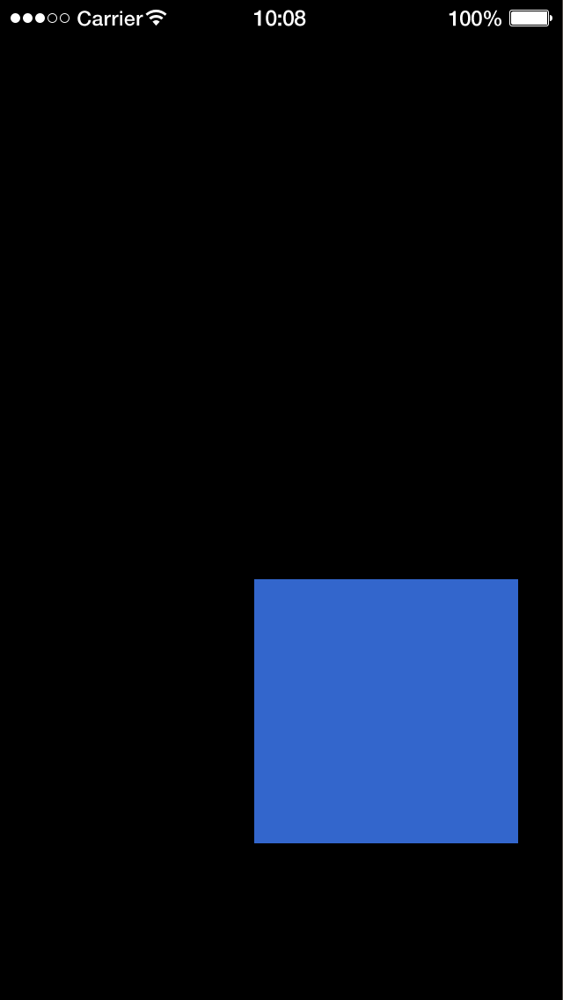

# dmc-gestures

Gesture recognizers for Solar2D (formerly Corona SDK): tap, long press, pan and pinch, modeled on iOS gesture recognizers.

Attach a gesture to a display object, and it watches the object's touches and sends one event when it sees its gesture, instead of a stream of raw touch events for you to interpret:

```lua
local Gesture = require 'dmc_corona.dmc_gestures'

local tap = Gesture.newTapGesture( square, { taps=2 } )    -- double tap
tap:addEventListener( tap.EVENT, function( event )
	print( 'double tap' )
end )
```

## Features

- Four gestures: tap, long press, pan (drag) and pinch (zoom), each with its number of touches, taps and tolerances
- Multi-touch: two-finger taps, three-finger pans, pinches
- Several gestures on one object: when one is recognized, the others give up, unless a delegate lets them run together (pan and pinch at the same time, for example)
- Pan, pinch and long press report `began`, `changed` and `ended`, with the center of the touches, the velocity of a pan or pinch and, for pinch, the scale
- Touches that begin on the object stay with it when they move off it, through [dmc-touchmanager](https://github.com/dmccuskey/dmc-touchmanager)
- Pure Lua, no plugins needed; MIT licensed

## Quick Start

The following code will get you up and running in about 10 minutes in the Solar2D Simulator on macOS or Windows. It makes a square that you drag around with a pan gesture and send back to the middle with a double tap.

Prerequisites: the [Solar2D](https://solar2d.com/) Simulator and a copy of this repository (`git clone https://github.com/dmccuskey/dmc-gestures.git`, or download the ZIP from GitHub). The Simulator has one touch, the mouse, so the Quick Start uses one-touch gestures; for multi-touch gestures, build to a device.

### 1. Copy the Library into Your Project

Copy these from this repository into the root of your project folder:

```text
dmc_corona_boot.lua     loader for the DMC libraries
dmc_corona.cfg          configuration
dmc_corona/             dmc-gestures and the libraries it uses
```

**Going further:** keep the libraries in a subfolder, or combine several DMC libraries ([dmc-corona-boot Configuration](https://github.com/dmccuskey/dmc-corona-boot/blob/master/docs/configuration.md)).

### 2. A Square to Drag and Double-Tap

Create `main.lua` in the project folder:

```lua
local Gesture = require 'dmc_corona.dmc_gestures'

local cx, cy = display.contentCenterX, display.contentCenterY
local square = display.newRect( cx, cy, 150, 150 )
square:setFillColor( 0.2, 0.4, 0.8 )

-- drag it with one finger
local pan = Gesture.newPanGesture( square )
local dx, dy  -- the square's offset from the touch

pan:addEventListener( pan.EVENT, function( event )
	if event.type ~= pan.GESTURE then return end
	if event.phase == 'began' then
		dx, dy = square.x - event.x, square.y - event.y
	else  -- 'changed' or 'ended'
		square.x, square.y = event.x + dx, event.y + dy
	end
	print( 'pan', event.phase, math.floor( square.x ), math.floor( square.y ) )
end )

-- double-tap to send it back to the middle
local tap = Gesture.newTapGesture( square, { taps=2 } )

tap:addEventListener( tap.EVENT, function( event )
	if event.type ~= tap.GESTURE then return end
	print( 'double tap' )
	transition.to( square, { x=cx, y=cy, time=300 } )
end )
```

Open the project in the Simulator and drag the square down and to the right: it follows the mouse, and the console shows lines like these:

```text
WARNING: Simulator does not support multitouch events
pan	began	160	240
pan	changed	175	270
pan	changed	190	300
...
pan	ended	220	360
```



Double-click the square: the console shows `double tap` and the square slides back to the middle. The two clicks must each be quick, and close together (300 ms).

The warning comes from Solar2D when dmc-gestures turns multitouch on; a device doesn't print it. The pan starts once the mouse has moved 10 points, so its `began` comes a little after the press.

If the console shows `module 'dmc_corona.dmc_gestures' not found` instead, `dmc_corona/` is missing from the root of the project folder.

**Going further:** the other gestures, their settings, the event fields, delegates and what to watch out for are in the [API reference](docs/api.md); the [examples](examples/) try each gesture, and several on one object.

To update, copy `dmc_corona_boot.lua` and `dmc_corona/` again from the newer version. Keep your own `dmc_corona.cfg` if you have changed it.

## Documentation

- [API reference](docs/api.md): the four gestures and their settings, the gesture event, several gestures on one object, delegates, known issues
- [Examples](examples/): each gesture on its own, several gestures on one object, a memory test
- [Changelog](CHANGELOG.md)

Everything else is listed on the [documentation home](docs/README.md).

## License

dmc-gestures is released under the [MIT License](LICENSE).
