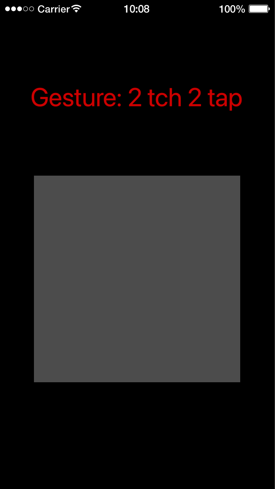
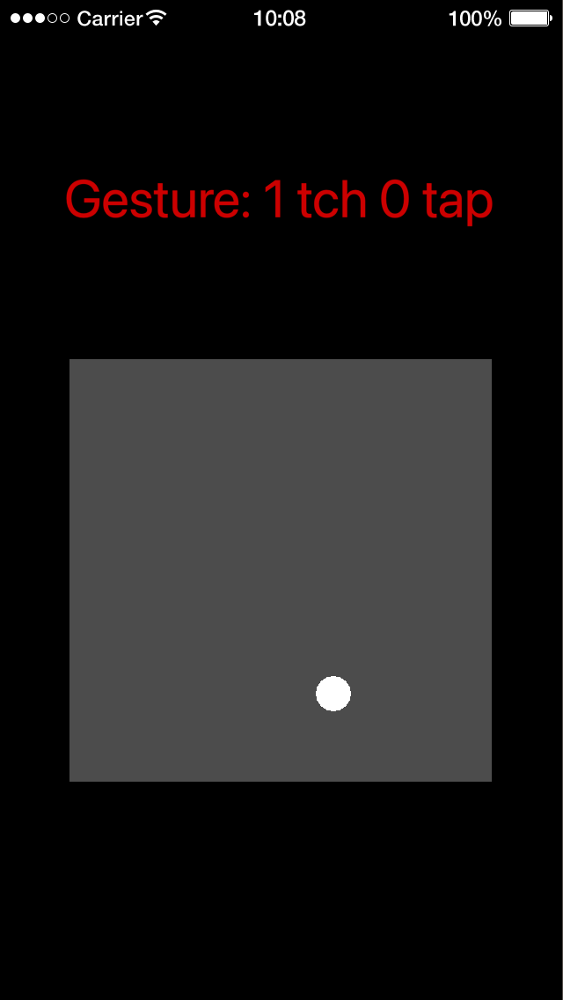
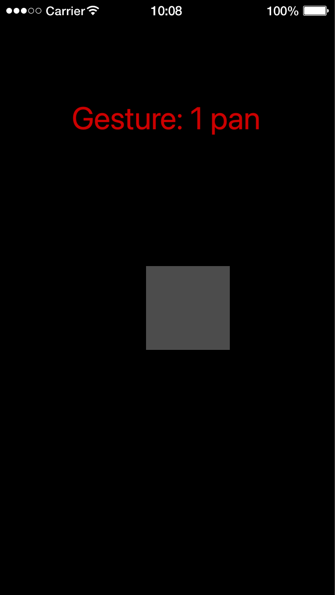
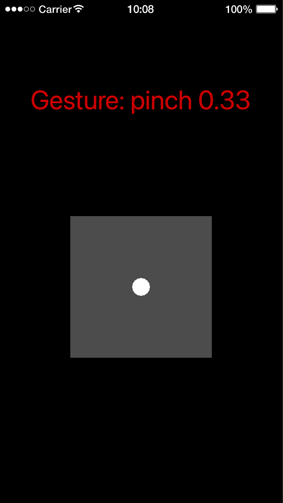
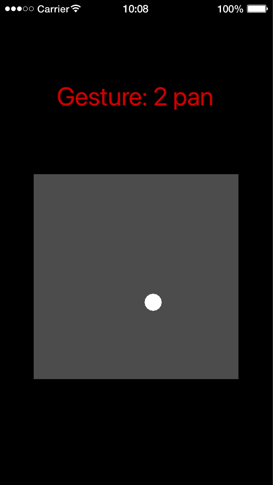
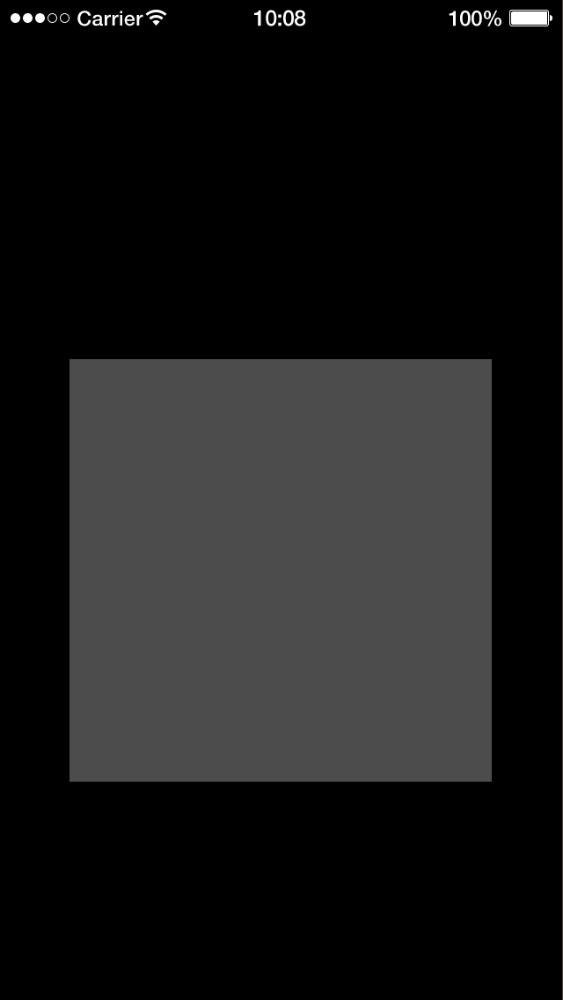

# Examples

Each folder is a complete Solar2D project with its own copy of the library: open its `main.lua` in the Solar2D Simulator. Most show a grey square with gestures attached, and print each gesture's `id` in red at the top when it's seen; the continuous gestures also put a white dot at the center of the fingers while they move.

The Simulator has one touch, the mouse: the one-finger gestures work with it, the others need a device (or scripted touches, see [Development](../docs/development.md#testing)). The screenshots were taken with scripted touches.

| | |
|---|---|
|  | **gesture-tap-basic**: three tap gestures on one square: one finger, one tap (`1 tch 1 tap`); two fingers, two taps (`2 tch 2 tap`); three fingers, one tap (`3 tch 1 tap`). A one-finger double tap shows `1 tch 1 tap` twice. |
|  | **gesture-longpress-basic**: six long presses on one square, for one, two or three fingers and zero, one or two taps before the press. Hold the mouse still on the square for half a second (`1 tch 0 tap`), then drag: the dot follows. Click once, then press and hold, for `1 tch 1 tap`. |
|  | **gesture-pan-basic**: pans for one, two and three fingers on one square. The dot is at the center of the fingers. |
|  | **gesture-pan-move**: one- and two-finger pans that move a small square. It puts the square's center under the fingers, so the square jumps when grabbed off-center; the [Quick Start](../README.md#quick-start) keeps the offset instead. |
|  | **gesture-pinch-basic**: a pinch that zooms the square, showing the pinch's `scale` (here, a pinch in to 0.33 after a pinch out to 2). |
|  | **gesture-multigesture-basic**: the three pans and three taps of the examples above, all on one square. Whichever matches first wins, and the others fail until the touches end. |
|  | **gesture-multigesture-simultaneous**: a one-finger pan, a pinch, and one- and two-finger double taps on one square, as a photo viewer would have. A delegate lets them all be recognized together instead of failing each other. (`main.lua` also has an `example_1()` with two pans and a pinch; it isn't called.) |
|  | **gesture-memtest**: a memory test. It makes a square with a random gesture and removes both, ten times a second, and prints the cycle count and the memory in use (`M:`, in KB) to the console, which should stay level (around 600 KB in the Simulator). |
